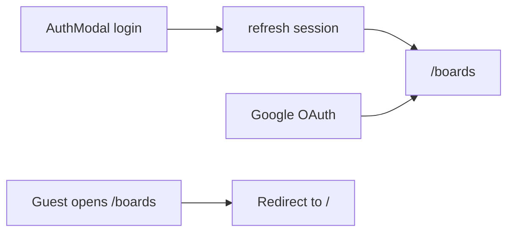

# PROJECT UPDATES

Дата обновления: 2026-09-09

## Что сделано

### 1) Базовый каркас проекта
- Инициализирован frontend на `React + TypeScript + Vite + Tailwind`.
- Подключен клиент `@supabase/supabase-js`.
- Добавлен шаблон переменных окружения в `.env.example`.

### 2) Редизайн лендинга
- Полностью обновлен лендинг в стиле AiVibeBoard:
  - крупная типографика;
  - светло-серый фон секций;
  - темно-синие контентные блоки;
  - оранжевые CTA и акцентные элементы.
- Страница разбита на секции:
  - `Header`
  - `HeroSection`
  - `TickerBar`
  - `FeaturesSection`
  - `ResultsSection`
  - `TelegramSection`
  - `TestimonialPricingSection`
  - `Footer`

### 3) UI авторизации
- Добавлен popup `AuthModal` с вкладками:
  - вход;
  - регистрация.
- Поля регистрации:
  - email;
  - пароль;
  - подтверждение пароля;
  - имя;
  - роль (выпадающий список IT-ролей).
- Улучшена контрастность модалки и сообщений (error/success), чтобы текст хорошо читался.

### 4) Интеграция с Supabase Auth
- Подключены реальные submit-обработчики:
  - вход через `supabase.auth.signInWithPassword`;
  - регистрация через `supabase.auth.signUp`.
- Добавлена логика сохранения профиля пользователя.
- Добавлены клиентские состояния:
  - `loading`;
  - `error`;
  - `success`.
- Добавлена базовая клиентская проверка:
  - совпадение пароля и подтверждения;
  - минимальная длина пароля;
  - выбранная роль.

### 5) Профиль пользователя в БД
- В Supabase создана таблица `public.profiles`:
  - `id uuid` (FK на `auth.users.id`);
  - `display_name text`;
  - `role text`;
  - `created_at timestamptz`.
- Включен RLS.
- Настроены политики на доступ только к своему профилю (`select/insert/update` для `auth.uid() = id`).
- Добавлен trigger на создание профиля при создании пользователя в `auth.users`.
- Выполнен security fix: отозваны публичные `EXECUTE` права у `SECURITY DEFINER` функции.

### 6) Отображение авторизованного состояния
- После входа пользователь перенаправляется на `/boards`.
- На лендинге и доске отображается блок аккаунта в `Header` (имя, роль, аватар, кнопка выхода).
- Добавлен хук `useAuth`:
  - чтение текущей сессии;
  - обновление профиля;
  - sign out.

## Ключевые файлы
- `src/App.tsx`
- `src/main.tsx`
- `src/pages/LandingPage.tsx`
- `src/pages/BoardsPage.tsx`
- `src/components/ProtectedRoute.tsx`
- `src/components/landing/AuthModal.tsx`
- `src/components/landing/AccountBadge.tsx`
- `src/components/landing/Header.tsx`
- `src/components/landing/ui.tsx`
- `src/hooks/useAuth.ts`
- `src/lib/auth.ts`
- `src/lib/database.types.ts`
- `src/lib/supabase.ts`
- `src/index.css`
- `tailwind.config.js`
- `.env.example`
- `docs/PROJECT_UPDATES.md`

## Настройка окружения

Создать `.env.local`:

```env
VITE_SUPABASE_URL=...
VITE_SUPABASE_ANON_KEY=...
```

### Cloudflare Workers Builds (GitHub)

Vite подставляет `VITE_*` на этапе сборки.

**Build settings в Cloudflare Dashboard:**

| Поле | Значение |
|------|----------|
| Build command | `npm run build` |
| Deploy command | `npx wrangler deploy` |

Статика: `wrangler.toml` → `[assets].directory = "./dist"`, SPA: `not_found_handling = "single-page-application"`.

**Не используйте:** `public/_redirects`, `wrangler pages deploy`, `npm run pages:deploy`, deploy command `dist`.

**Environment variables** (Production + Preview):

- `VITE_SUPABASE_URL`
- `VITE_SUPABASE_ANON_KEY`

Локально: `.env.local`. Деплой: `npm run deploy` или `powershell -File scripts/deploy-cloudflare.ps1`.

## Проверка
- `npm run build` проходит успешно.
- Авторизация и регистрация работают через Supabase.
- После логина пользователь попадает на `/boards`.

### 7) Google OAuth через Supabase
- Добавлен вход через Google в `AuthModal` (кнопка «Войти через Google» во вкладке логина).
- В `src/lib/auth.ts` добавлен метод `signInWithGoogle()` на базе `supabase.auth.signInWithOAuth`.
- Для OAuth задан `redirectTo` на `${window.location.origin}/boards`.
- Ошибки/состояния загрузки для Google-входа интегрированы в общую логику модалки.
- Обновлено сообщение о невалидной конфигурации Supabase для локального и Cloudflare-окружений.

#### Что проверить в Supabase
- Включен провайдер Google в Authentication → Providers.
- В Redirect URLs добавлены:
  - `http://localhost:5173/boards`
  - Production-домен Cloudflare (например, `https://<your-domain>.pages.dev/boards`).

### 8) Страница boards и post-login redirect
- Подключён `react-router-dom`; приложение обёрнуто в `BrowserRouter` (`src/main.tsx`).
- `App.tsx` стал контейнером маршрутов вместо монолитного лендинга.
- Лендинг вынесен в `src/pages/LandingPage.tsx`.
- Добавлена приватная страница `src/pages/BoardsPage.tsx` с базовым каркасом доски (колонки-заглушки).
- Добавлен guard `src/components/ProtectedRoute.tsx`:
  - авторизованный пользователь видит `/boards`;
  - гость перенаправляется на `/`.
- После успешного email/пароль логина и регистрации (без подтверждения email) пользователь попадает на `/boards`.
- Google OAuth `redirectTo` обновлён на `${window.location.origin}/boards`.

#### Маршруты
| URL | Доступ | Описание |
|-----|--------|----------|
| `/` | публичный | лендинг с модалкой авторизации |
| `/boards` | только авторизованные | доска задач (placeholder) |

#### Поток после входа


#### Новые и изменённые файлы
- `src/main.tsx` — `BrowserRouter`
- `src/App.tsx` — `Routes` (`/`, `/boards`)
- `src/pages/LandingPage.tsx` — лендинг + `navigate('/boards')` после входа
- `src/pages/BoardsPage.tsx` — страница доски
- `src/components/ProtectedRoute.tsx` — guard по `useAuth`
- `src/lib/auth.ts` — OAuth redirect на `/boards`
- `package.json` — зависимость `react-router-dom`

#### Проверка
- `npm run build` проходит успешно.
- Email login → редирект на `/boards`.
- Google login → возврат на `/boards` (после добавления URL в Supabase Redirect URLs).
- Прямой заход на `/boards` без сессии → редирект на `/`.
- Выход с доски → возврат на лендинг `/`.
- SPA fallback в `wrangler.toml` (`not_found_handling = "single-page-application"`) поддерживает client-side маршруты.

### 9) Обязательный выбор роли после Google OAuth
- Добавлен post-auth onboarding для OAuth-пользователей:
  - если профиль неполный, доступ к `/boards` блокируется;
  - пользователь перенаправляется на `/onboarding`;
  - после выбора роли и сохранения профиля перенаправляется обратно на `/boards`.
- Обновлён `ProtectedRoute`:
  - проверяет не только факт авторизации, но и `profileComplete`;
  - поддерживает режим без проверки полноты профиля для `/onboarding`.
- Добавлена страница `src/pages/OnboardingPage.tsx`:
  - обязательный выбор роли из общего списка;
  - сохранение `role` и `display_name` в `profiles` и `user_metadata`.
- Список ролей вынесен в `src/lib/roles.ts` и переиспользуется в:
  - `AuthModal` (email-регистрация),
  - `OnboardingPage` (OAuth onboarding).
- В `AuthModal` Google OAuth теперь доступен и в сценарии регистрации:
  - во вкладке входа кнопка: «Войти или зарегистрироваться через Google»;
  - во вкладке регистрации кнопка: «Зарегистрироваться через Google».

#### Поток Google OAuth (актуальный)
```mermaid
flowchart TD
  googleLogin[GoogleOAuthButton] --> oauth[SupabaseOAuth]
  oauth --> boardsRoute[/boards]
  boardsRoute --> profileCheck{profileComplete?}
  profileCheck -->|no| onboardingRoute[/onboarding]
  onboardingRoute --> updateProfile[Save role and displayName]
  updateProfile --> boardsAccess[/boards]
  profileCheck -->|yes| boardsAccess
```

#### Что проверить в Supabase для Google
- Провайдер Google включён в Authentication → Providers.
- В Redirect URLs добавлен URL:
  - `http://localhost:5173/boards`
  - production URL (например, `https://<your-domain>/boards`)

### 10) Страница просмотра доски (UI-only)
- Добавлен новый приватный маршрут `/boards/:boardId` в `src/App.tsx`.
- Создана страница `src/pages/BoardViewPage.tsx`:
  - заголовок доски и мета-информация;
  - канбан-колонки и карточки;
  - состояние `not-found` для несуществующей доски.
- Добавлены мок-данные в `src/mocks/boardViewMock.ts` для UI-режима без backend-зависимости.
- На `src/pages/BoardsPage.tsx` добавлена кнопка перехода «Открыть доску».

### 11) Выбор исполнителя карточки из БД
- Добавлен модуль `src/lib/profiles.ts`:
  - загрузка пользователей из `public.profiles`;
  - утилиты фильтрации и вычисления инициалов.
- Добавлен компонент `src/components/board/AssigneePicker.tsx`:
  - назначение исполнителя карточки;
  - поиск по пользователям;
  - фильтр пользователей по роли.
- Назначение работает в UI-only режиме (локальное состояние страницы), без записи в БД.

### 12) Доступ к списку профилей для назначения
- Применена миграция Supabase `allow_authenticated_read_profiles`.
- Обновлены RLS-политики `public.profiles`:
  - удалена политика чтения только своего профиля;
  - добавлена политика чтения профилей для роли `authenticated`.
- Политики `insert/update` остались ограничены условием `auth.uid() = id`.

### 13) Мультивыбор участников доски и отображение иконок
- Добавлен компонент `src/components/board/BoardMembersPicker.tsx` c UX меню доступа к доске:
  - блок «Кто видит доску» с текущими участниками;
  - блок «Добавить пользователя» с поиском по имени/роли и фильтром по ролям;
  - добавление/удаление нескольких участников.
- В `BoardViewPage` добавлено локальное состояние `memberIds` и отображение выбранных участников аватарками в шапке доски.
- Фильтрация в меню участников влияет только на список пользователей в popover и не фильтрует карточки/задачи доски.

## Ключевые файлы (добавлены/обновлены в последних изменениях)
- `src/App.tsx`
- `src/pages/BoardViewPage.tsx`
- `src/pages/BoardsPage.tsx`
- `src/mocks/boardViewMock.ts`
- `src/lib/profiles.ts`
- `src/components/board/AssigneePicker.tsx`
- `src/components/board/BoardMembersPicker.tsx`

### 14) Перевод доски на БД `tasks` + `task_assignees`
- В Supabase добавлены таблицы:
  - `public.tasks` (карточки доски);
  - `public.task_assignees` (многие-ко-многим для исполнителей).
- Добавлены индексы по порядку карточек и связям.
- Включены RLS-политики в стиле существующей модели доступа к доске (владелец доски).
- Обновлены клиентские типы `src/lib/database.types.ts`.

### 15) Синхронизация drag&drop и назначений с БД
- Добавлен модуль `src/lib/boardTasks.ts`:
  - загрузка доски из `boards` + `board_columns` + `tasks` + `task_assignees`;
  - сохранение порядка и статусов карточек после перетаскивания;
  - синхронизация множественных исполнителей.
- Убран UI-only персист назначений через `localStorage`.
- `src/pages/BoardViewPage.tsx` использует Supabase как источник правды.

### 16) CRUD карточек на доске
- Добавлено создание, редактирование и удаление карточек с сохранением в БД.
- Для карточки реализованы поля:
  - текст задачи (обязателен);
  - дедлайн (опционально);
  - исполнители (опционально, мультивыбор).
- Добавлены новые UI-компоненты:
  - `src/components/board/TaskFormModal.tsx`;
  - `src/components/board/DeleteTaskModal.tsx`.
- Реализованы optimistic update и откат состояния при ошибках сохранения.

### 17) Стабилизация размеров карточек
- Карточки получили фиксированную высоту с адаптацией по брейкпоинтам:
  - mobile: `210px`;
  - `sm+`: `220px`.
- Внутренняя верстка карточки и блока исполнителей выровнена так, чтобы контент не выходил за границы.

### 18) Гибкие колонки доски и миграция Supabase
- Применена миграция `flexible_board_columns_and_task_status`:
  - в `board_columns` добавлено поле `status_key` (источник правды для статуса карточек в колонке);
  - снято ограничение `tasks.status` на фиксированный набор `todo/in_progress/done`;
  - добавлены индексы для операций с колонками и порядком карточек.
- Логика доски переведена на `column_id` + `status_key` вместо жёсткой привязки к позиции колонки.
- Обновлены типы `src/lib/database.types.ts`.

### 19) CRUD колонок и новые дефолтные колонки
- При создании доски теперь создаются 4 колонки:
  - `Backlog`;
  - `In progress`;
  - `Review`;
  - `Done`.
- В `src/lib/boardTasks.ts` добавлены операции:
  - `createBoardColumn` — новая колонка в конец списка;
  - `updateBoardColumn` — переименование;
  - `deleteBoardColumn` — удаление с переносом всех карточек в `Backlog`;
  - `reindexBoardColumns` — пересчёт `position` после удаления или перестановки.
- Колонку `Backlog` удалить нельзя.
- Добавлены UI-компоненты:
  - `src/components/board/ColumnFormModal.tsx`;
  - `src/components/board/DeleteColumnModal.tsx`.
- На `BoardViewPage`:
  - кнопка `+ Колонка`;
  - в заголовке колонки — редактирование и удаление;
  - счётчики карточек в шапке доски строятся динамически по всем колонкам.

### 20) Перестановка колонок drag&drop
- В заголовке каждой колонки добавлена ручка перетаскивания (слева от названия).
- Колонку можно перетащить на место другой колонки; порядок сохраняется в `board_columns.position` через `reindexBoardColumns`.
- Перетаскивание колонок и карточек разделено: колонки — за ручку в header, карточки — как раньше.
- При ошибке сохранения порядок колонок откатывается в UI.

### 21) Исправление наложения элементов в заголовке колонки
- Заголовок колонки переведён на двухстрочную структуру:
  - верхняя строка: ручка + название (`break-words`);
  - нижняя строка: счётчик карточек и кнопки действий.
- Длинные названия (например, «Промежуточный результат») больше не перекрывают иконки редактирования/удаления и кнопку `+ Карточка`.

## Ключевые файлы (колонки доски)
- `src/lib/boardTasks.ts`
- `src/lib/boards.ts`
- `src/lib/database.types.ts`
- `src/mocks/boardViewMock.ts`
- `src/pages/BoardViewPage.tsx`
- `src/components/board/ColumnFormModal.tsx`
- `src/components/board/DeleteColumnModal.tsx`
- `docs/PROJECT_UPDATES.md`

#### Проверка (колонки)
- `npm run build` проходит успешно.
- Создание новой доски → 4 дефолтные колонки.
- Создание/переименование/удаление колонки сохраняется в Supabase.
- Удаление непустой колонки → карточки переносятся в `Backlog`.
- Drag&drop колонок и карточек сохраняется после перезагрузки страницы.

### 22) UI-полировка лендинга, списка досок и участников
- В `src/index.css` добавлены общие утилиты:
  - `panel-shell`, `chip`;
  - micro-interactions: `hover-lift`, `press-down`, `transition-soft`;
  - анимации появления: `motion-fade-in`, `motion-scale-in`, `motion-stagger`;
  - отключение анимаций при `prefers-reduced-motion`.
- Обновлены секции лендинга и страницы onboarding под единый визуальный язык.
- `BoardsPage`: градиентный фон, sticky header, chips со статистикой, улучшенный sidebar и карточки досок.
- `BoardMembersPicker`: popover заменён на полноэкранную модалку через `createPortal` (без overflow-глюков).
- Расширен `tailwind.config.js` под новые utility-классы.

## Ключевые файлы (UI-полировка)
- `src/index.css`
- `tailwind.config.js`
- `src/pages/BoardsPage.tsx`
- `src/pages/LandingPage.tsx`
- `src/pages/OnboardingPage.tsx`
- `src/components/board/BoardMembersPicker.tsx`
- `src/components/landing/*`

### 23) Приоритет и описание карточки
- Применена миграция Supabase `add_task_priority_and_description`:
  - `tasks.priority text NOT NULL DEFAULT 'medium'` с проверкой `low | medium | high`;
  - `tasks.description text NULL`.
- Существующие карточки получают `priority = 'medium'` автоматически.
- Расширена модель карточки:
  - тип `TaskPriority` в `src/mocks/boardViewMock.ts`;
  - поля `priority` и `description` в `BoardTask`, `database.types.ts` и `boardTasks.ts`.
- CRUD карточек сохраняет приоритет и описание в БД (`createTask`, `updateTask`).
- Форма карточки (`TaskFormModal`):
  - селект приоритета: Низкий / Средний / Высокий (дефолт — Средний);
  - textarea описания (необязательно).
- На карточке доски (`BoardViewPage` → `TaskCard`):
  - бейдж приоритета в верхней строке (цвет зависит от уровня);
  - превью описания до 2 строк под заголовком, если поле заполнено.
- Карточки используют `min-h` вместо фиксированной высоты, чтобы контент с описанием не обрезался.

#### Модель данных (tasks)
| Поле | Тип | Значения / дефолт |
|------|-----|-------------------|
| `priority` | `text NOT NULL` | `low`, `medium` (default), `high` |
| `description` | `text NULL` | произвольный текст или `NULL` |

#### Ключевые файлы
- `src/lib/boardTasks.ts`
- `src/lib/database.types.ts`
- `src/mocks/boardViewMock.ts`
- `src/components/board/TaskFormModal.tsx`
- `src/pages/BoardViewPage.tsx`
- `docs/PROJECT_UPDATES.md`

#### Проверка
- `npm run build` проходит успешно.
- Создание карточки с приоритетом «Высокий» и описанием → данные видны на карточке и в форме редактирования.
- Редактирование приоритета/описания → изменения сохраняются в Supabase.
- Перезагрузка страницы → значения подтягиваются из БД.

### 24) Комментарии к карточкам и вложения через Cloudflare R2
- Добавлена таблица `public.task_comments`:
  - `task_id`, `author_id`, `body`, `attachment_url`, `attachment_name`, `attachment_size`, `attachment_mime`, `created_at`;
  - индекс по `task_id` и `created_at`;
  - RLS-политики в модели доступа владельца доски, удаление только автором комментария.
- Добавлена Edge Function `r2-upload-url`:
  - проверяет JWT и доступ к задаче;
  - валидирует `fileSize` и `contentType`;
  - генерирует presigned `PUT` URL для Cloudflare R2;
  - возвращает публичную ссылку `publicUrl`, которая сохраняется в БД.
- На UI доски добавлена модалка комментариев `TaskCommentsModal`:
  - список комментариев по задаче;
  - создание комментария с текстом и/или файлом;
  - удаление собственного комментария.
- Реализован клиентский upload-поток:
  1) запрос presigned URL у `r2-upload-url`;
  2) загрузка файла напрямую в R2;
  3) сохранение в `task_comments` только ссылки и метаданных файла.
- Улучшена диагностика ошибок:
  - если в Supabase не хватает `R2_*` secrets, функция возвращает список `missingKeys`;
  - клиент показывает понятное сообщение пользователю вместо generic `non-2xx`.

#### Новые/обновлённые файлы (R2 + comments)
- `supabase/migrations/20260909180000_create_task_comments.sql`
- `supabase/functions/r2-upload-url/index.ts`
- `supabase/config.toml`
- `src/components/board/TaskCommentsModal.tsx`
- `src/lib/taskComments.ts`
- `src/lib/r2Uploads.ts`
- `src/pages/BoardViewPage.tsx`
- `src/lib/database.types.ts`
- `.env.example`
- `.gitignore`

#### Secrets для Edge Function
Добавляются в Supabase Dashboard → Edge Functions → Secrets:

```env
R2_ACCOUNT_ID=...
R2_BUCKET_NAME=...
R2_PUBLIC_BASE_URL=...
R2_ACCESS_KEY_ID=...
R2_SECRET_ACCESS_KEY=...
```

#### Проверка
- `npm run build` проходит успешно.
- Комментарий без файла сохраняется в `task_comments`.
- Комментарий с файлом загружает объект в R2, в Supabase сохраняется только ссылка и метаданные.
- Ссылка из `attachment_url` открывает загруженный файл при корректном CORS/Public URL.

### 25) AI-оркестратор задач через Edge Function `anymodel-chat`
- Функция `supabase/functions/anymodel-chat/index.ts` переведена из простого chat-прокси в оркестратор постановки задач.
- Новый сценарий:
  1) принимает глобальную задачу (`boardId`, `title`, `description?`, `dueAt?`, опционально `columnId/status`);
  2) вызывает AnyModel для разбиения на подзадачи;
  3) подбирает исполнителей по `profiles.role` с учетом текущей нагрузки;
  4) создает эпик (`kind='epic'`) и дочерние подзадачи (`kind='task'`, `parent_id=epic.id`);
  5) сохраняет назначения в `task_assignees`.
- Для надежности добавлен rollback: при ошибке записи частично созданные задачи удаляются.
- `verify_jwt` для `anymodel-chat` включен (`supabase/config.toml`), вызов только от авторизованного пользователя.
- Добавлен fallback backlog: если `columnId/status` не переданы, функция находит колонку по `status_key='backlog'` в текущей доске.
- В ответ функции добавлены поля для UI-обновления без полного рефетча: `boardTasks`, `backlogColumnId`, `backlogStatus`, `warnings`, `unmatchedRoles`.

### 26) Live-чат на доске с автопостановкой задач
- Добавлена таблица `public.board_messages` (миграция `supabase/migrations/20260914190000_create_board_messages.sql`):
  - `board_id`, `author_id`, `body`, `ai_run_status`, `ai_result_summary`, `created_at`;
  - RLS-политики в текущей модели доступа владельца доски;
  - подключение к `supabase_realtime` publication.
- Добавлен клиентский API-слой `src/lib/boardChat.ts`:
  - `listBoardMessages`, `createBoardMessage`, `updateBoardMessageAiStatus`;
  - `subscribeBoardMessages` через `postgres_changes`;
  - `runBoardMessageAiSplit` для вызова `anymodel-chat`;
  - mapper `mapAiSplitToBoardTasks` для приведения ответа к `BoardTask`.
- Добавлен UI-компонент `src/components/board/BoardChatPanel.tsx`:
  - список сообщений;
  - ввод и отправка;
  - статусы AI (`processing/success/error`) и summary результата.
- `src/pages/BoardViewPage.tsx` обновлен:
  - чат встроен в layout страницы доски рядом с колонками;
  - сообщения загружаются и синхронизируются в realtime;
  - каждое сообщение запускает AI-разбиение;
  - созданные эпик/подзадачи мгновенно добавляются в backlog текущей доски.
- Добавлены типы `board_messages` в `src/lib/database.types.ts`.

#### Проверка (AI chat flow)
- `npm run build` проходит успешно.
- Отправка сообщения в чате создает запись в `board_messages` и статус `processing`.
- После завершения AI появляются новые карточки в backlog текущей доски.
- Сообщение получает статус `success` и summary о количестве созданных задач.
- При ошибке AI сообщение сохраняется со статусом `error` и текстом ошибки.

## Telegram webhook-бот `telegram-ok-reply`

Edge Function: `supabase/functions/telegram-ok-reply/index.ts`

Поведение: Telegram шлёт update на webhook. Бот показывает доски владельца и создаёт глобальные задачи через AI с выбором доски (inline-кнопки). На остальные сообщения отвечает `ок`.

Полная документация: [`docs/TELEGRAM_BOT.md`](TELEGRAM_BOT.md)

Кратко:
- `/start` — приветствие и кнопки `Список досок`, `Создать задачу`;
- `Список досок` / `/boards` — доски пользователя по `telegram_username`;
- `Создать задачу` — inline-выбор доски → текст задачи → `anymodel-chat` (Telegram internal mode);
- сессия диалога хранится в `telegram_task_sessions`;
- нужен секрет `TELEGRAM_INTERNAL_SECRET` на обеих Edge Functions;
- username задаётся в «Настройках» веб-приложения;
- секреты — Supabase Vault (`telegram_bot_token`, `telegram_poll_secret`) или env Edge Function;
- деплой — `supabase functions deploy telegram-ok-reply`;
- webhook — `setWebhook` на URL функции с тем же `secret_token`.

### 27) Telegram-уведомления о назначении задач (UI + AI)
- Добавлен серверный pipeline уведомлений о назначении через `task_assignees` без дублирования логики на клиенте.
- Применены миграции:
  - `20260916190000_telegram_assignment_notifications.sql`;
  - `20260916190500_telegram_assignment_notify_cron.sql`.
- Добавлены объекты БД:
  - `telegram_profile_links` (`profile_id`, `chat_id`, `telegram_username`, `last_seen_at`);
  - `telegram_assignment_notifications` (очередь отправок, `status`, `attempts`, `error`);
  - trigger `task_assignees_enqueue_telegram_notification`;
  - функция `invoke_telegram_assignment_notify()` + cron-job `telegram-assignment-notify` (каждые 2 минуты).
- В `telegram-ok-reply` добавлен upsert связи профиля и Telegram-чата при валидных update.
- Добавлена Edge Function `telegram-assignment-notify`:
  - выбирает `pending`/retry записи из очереди;
  - отправляет Telegram `sendMessage`;
  - отмечает `sent`, при ошибках обновляет `attempts` и оставляет в retry.
- Обновлены TS-типы БД (`src/lib/database.types.ts`) для новых таблиц Telegram.

#### Поведение
- Назначение из UI или AI автоматически пишет в `task_assignees` -> trigger ставит задачу в очередь.
- Уведомление отправляется только профилям с подтвержденной связью в `telegram_profile_links`.
- Дубли предотвращаются уникальным ключом по `task_id + profile_id`.
- Ошибки Telegram API не ломают транзакцию назначения: карточка назначается, доставка уходит в retry.

#### Что проверить
- Пользователь пишет `/start` (или другое сообщение) и получает запись в `telegram_profile_links`.
- Ручное назначение карточки из доски отправляет одно уведомление подключенному исполнителю.
- AI-назначения из `anymodel-chat` также попадают в очередь и отправляются.
- Профиль без связи не получает уведомление.

---

## 2026-09-21 — Биллинг: лимиты тарифов, отмена и апгрейд

### Лимиты по планам
- Light: 1 проект, до 3 участников; Pro/Enterprise: лимиты участников и ИИ — см. `docs/BILLING_PLAN_LIMITS.md`.
- Миграции: лимит досок, `board_members` + триггеры, `cancel_at_period_end` в `billing_subscriptions`.
- UI: `/billing` (использование, тарифы), доска (участники, чат ИИ), `/boards` (создание проекта).

### Подписка Stripe
- Edge Functions: `stripe-cancel-subscription`, `stripe-upgrade-subscription`; обновлены checkout/webhook.
- Повышение только Light → Pro → Enterprise; понижение после отмены и конца периода.
- Документация: `docs/STRIPE_BILLING.md`, `docs/BILLING_PLAN_LIMITS.md`.

---

## 2026-09-23 — KB чат, профиль и UX-обновления

### 1) Глобальный лайв-чат базы знаний
- Добавлен виджет `src/components/KnowledgeLiveChatWidget.tsx`, доступный на всех страницах (включая доски).
- Интеграция с Supabase Edge Function `dify-knowledge-query` через `src/lib/knowledgeQuery.ts`.
- UX чата:
  - история сообщений, статусы ожидания ответа;
  - быстрые подсказки запросов;
  - рендер `sources` (документ, score, excerpt);
  - дружественная нормализация ошибок провайдера.

### 2) Лендинг: исправление CTA и навигации
- Кнопки на лендинге перестали быть заглушками:
  - Hero CTA ведет в регистрацию/доски в зависимости от авторизации;
  - кнопка «Как это работает» скроллит к секции;
  - Telegram CTA ведет в `/settings` (или в логин с post-auth redirect).
- Добавлен общий helper якорей: `src/lib/landingAnchors.ts`.
- В header для авторизованных добавлена кнопка/ссылка «Доски».
- В секции тарифов удален переключатель «Ежегодно», оставлены помесячные цены.

### 3) Настройки профиля: расширенный кабинет
- Страница `src/pages/SettingsPage.tsx` разбита на отдельные секции:
  - Профиль (имя, должность, email readonly);
  - Telegram (username);
  - Безопасность (смена пароля для email-login).
- Добавлен кастомный селект должности: `src/components/RoleSelectField.tsx`.
- В местах, где упоминается Telegram, используется единая иконка `TelegramIcon` (добавлена в `src/components/landing/ui.tsx`).

### 4) Аватары пользователя
- Добавлена поддержка аватаров:
  - 5 встроенных пресетов;
  - загрузка собственного изображения в R2 (до 2 МБ, только image/*).
- Новые файлы:
  - `src/lib/profileAvatar.ts`;
  - `src/components/UserAvatar.tsx`;
  - `src/components/settings/AvatarPicker.tsx`.
- `AccountBadge` обновлен:
  - показывает выбранный аватар;
  - клик по блоку профиля открывает `/settings`.

### 5) БД и серверные изменения под аватары
- Миграция: `supabase/migrations/20260923193000_profile_avatars.sql`:
  - `profiles.avatar_preset`;
  - `profiles.avatar_url`.
- `supabase/functions/r2-upload-url/index.ts` расширена:
  - добавлен `purpose=profile_avatar`;
  - отдельные лимиты и mime-валидация для аватаров.
- Обновлены типы БД: `src/lib/database.types.ts`.

### 6) Устойчивость авторизации и модалки
- Исправлен конфликт слоев: `AuthModal` поднят выше плавающего KB-чата (`z-[110]`).
- В `src/lib/auth.ts` добавлен fallback чтения профиля без avatar-колонок:
  - если миграция еще не применена, вход не ломается;
  - пользователь остается авторизованным даже при частичной несовместимости схемы.
- В `src/lib/supabase.ts` добавлен project URL по умолчанию и строгая проверка наличия publishable key.

### 7) Деплой
- Фронтенд деплоится через `npm run deploy` (Wrangler).
- Для полного запуска аватаров в production необходимо:
  1) применить миграцию БД (`supabase db push` или SQL в Dashboard);
  2) задеплоить Edge Function `r2-upload-url`;
  3) убедиться, что client build получает `VITE_SUPABASE_URL` и `VITE_SUPABASE_ANON_KEY`.

---

## 2026-09-28 — UX меню профиля и глобальная смена палитры

### 1) Меню профиля вместо большого modal/iframe
- В `src/components/landing/AccountBadge.tsx` убран полноэкранный `iframe` настроек.
- По клику на бейдж аккаунта теперь открывается компактное dropdown-меню:
  - `Настройка профиля`
  - `Настройка аватара`
  - `Настройка Telegram`
  - `Безопасность`
- Пункты ведут на `/settings` с hash-якорями и закрывают меню при выборе.
- Добавлено UX-поведение:
  - закрытие по клику вне меню;
  - закрытие по `Escape`.

### 2) Якоря секций на странице настроек
- В `src/pages/SettingsPage.tsx` добавлены id-секции и отступы для корректного позиционирования под sticky-header:
  - `#profile-settings`
  - `#avatar-settings`
  - `#telegram-settings`
  - `#security-settings`
- Класс `scroll-mt-24` добавлен для точного скролла к нужному блоку.

### 3) Глобальная цветовая тема (все страницы)
- Базовая палитра проекта обновлена на уровне дизайн-токенов (`tailwind.config.js`):
  - основной фон/поверхности → бежевые;
  - акцентные кнопки и выделения → оранжевые;
  - прежний темно-синий (`navy`) → темно-бежевые оттенки.
- Обновлены тени карточек/hero/buttons под новую гамму.
- В `src/index.css` скорректированы цвета служебных элементов:
  - `dot-grid`;
  - цвета скроллбаров board-area.

### Затронутые файлы
- `src/components/landing/AccountBadge.tsx`
- `src/pages/SettingsPage.tsx`
- `tailwind.config.js`
- `src/index.css`
