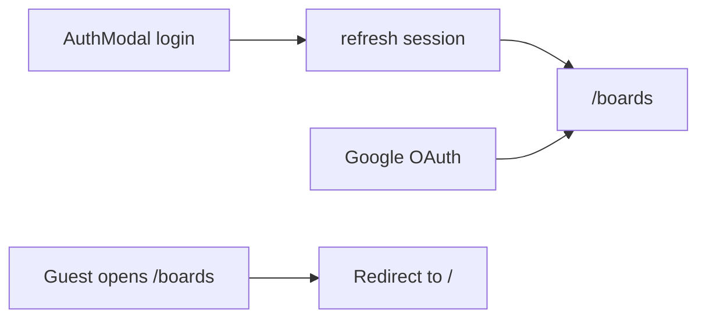

# PROJECT UPDATES

Дата обновления: 2026-09-09

## Что сделано

### 1) Базовый каркас проекта
- Инициализирован frontend на `React + TypeScript + Vite + Tailwind`.
- Подключен клиент `@supabase/supabase-js`.
- Добавлен шаблон переменных окружения в `.env.example`.

### 2) Редизайн лендинга
- Полностью обновлен лендинг в стиле AiVibeBoard:
  - крупная типографика;
  - светло-серый фон секций;
  - темно-синие контентные блоки;
  - оранжевые CTA и акцентные элементы.
- Страница разбита на секции:
  - `Header`
  - `HeroSection`
  - `TickerBar`
  - `FeaturesSection`
  - `ResultsSection`
  - `TelegramSection`
  - `TestimonialPricingSection`
  - `Footer`

### 3) UI авторизации
- Добавлен popup `AuthModal` с вкладками:
  - вход;
  - регистрация.
- Поля регистрации:
  - email;
  - пароль;
  - подтверждение пароля;
  - имя;
  - роль (выпадающий список IT-ролей).
- Улучшена контрастность модалки и сообщений (error/success), чтобы текст хорошо читался.

### 4) Интеграция с Supabase Auth
- Подключены реальные submit-обработчики:
  - вход через `supabase.auth.signInWithPassword`;
  - регистрация через `supabase.auth.signUp`.
- Добавлена логика сохранения профиля пользователя.
- Добавлены клиентские состояния:
  - `loading`;
  - `error`;
  - `success`.
- Добавлена базовая клиентская проверка:
  - совпадение пароля и подтверждения;
  - минимальная длина пароля;
  - выбранная роль.

### 5) Профиль пользователя в БД
- В Supabase создана таблица `public.profiles`:
  - `id uuid` (FK на `auth.users.id`);
  - `display_name text`;
  - `role text`;
  - `created_at timestamptz`.
- Включен RLS.
- Настроены политики на доступ только к своему профилю (`select/insert/update` для `auth.uid() = id`).
- Добавлен trigger на создание профиля при создании пользователя в `auth.users`.
- Выполнен security fix: отозваны публичные `EXECUTE` права у `SECURITY DEFINER` функции.

### 6) Отображение авторизованного состояния
- После входа пользователь перенаправляется на `/boards`.
- На лендинге и доске отображается блок аккаунта в `Header` (имя, роль, аватар, кнопка выхода).
- Добавлен хук `useAuth`:
  - чтение текущей сессии;
  - обновление профиля;
  - sign out.

## Ключевые файлы
- `src/App.tsx`
- `src/main.tsx`
- `src/pages/LandingPage.tsx`
- `src/pages/BoardsPage.tsx`
- `src/components/ProtectedRoute.tsx`
- `src/components/landing/AuthModal.tsx`
- `src/components/landing/AccountBadge.tsx`
- `src/components/landing/Header.tsx`
- `src/components/landing/ui.tsx`
- `src/hooks/useAuth.ts`
- `src/lib/auth.ts`
- `src/lib/database.types.ts`
- `src/lib/supabase.ts`
- `src/index.css`
- `tailwind.config.js`
- `.env.example`
- `docs/PROJECT_UPDATES.md`

## Настройка окружения

Создать `.env.local`:

```env
VITE_SUPABASE_URL=...
VITE_SUPABASE_ANON_KEY=...
```

### Cloudflare Workers Builds (GitHub)

Vite подставляет `VITE_*` на этапе сборки.

**Build settings в Cloudflare Dashboard:**

| Поле | Значение |
|------|----------|
| Build command | `npm run build` |
| Deploy command | `npx wrangler deploy` |

Статика: `wrangler.toml` → `[assets].directory = "./dist"`, SPA: `not_found_handling = "single-page-application"`.

**Не используйте:** `public/_redirects`, `wrangler pages deploy`, `npm run pages:deploy`, deploy command `dist`.

**Environment variables** (Production + Preview):

- `VITE_SUPABASE_URL`
- `VITE_SUPABASE_ANON_KEY`

Локально: `.env.local`. Деплой: `npm run deploy` или `powershell -File scripts/deploy-cloudflare.ps1`.

## Проверка
- `npm run build` проходит успешно.
- Авторизация и регистрация работают через Supabase.
- После логина пользователь попадает на `/boards`.

### 7) Google OAuth через Supabase
- Добавлен вход через Google в `AuthModal` (кнопка «Войти через Google» во вкладке логина).
- В `src/lib/auth.ts` добавлен метод `signInWithGoogle()` на базе `supabase.auth.signInWithOAuth`.
- Для OAuth задан `redirectTo` на `${window.location.origin}/boards`.
- Ошибки/состояния загрузки для Google-входа интегрированы в общую логику модалки.
- Обновлено сообщение о невалидной конфигурации Supabase для локального и Cloudflare-окружений.

#### Что проверить в Supabase
- Включен провайдер Google в Authentication → Providers.
- В Redirect URLs добавлены:
  - `http://localhost:5173/boards`
  - Production-домен Cloudflare (например, `https://<your-domain>.pages.dev/boards`).

### 8) Страница boards и post-login redirect
- Подключён `react-router-dom`; приложение обёрнуто в `BrowserRouter` (`src/main.tsx`).
- `App.tsx` стал контейнером маршрутов вместо монолитного лендинга.
- Лендинг вынесен в `src/pages/LandingPage.tsx`.
- Добавлена приватная страница `src/pages/BoardsPage.tsx` с базовым каркасом доски (колонки-заглушки).
- Добавлен guard `src/components/ProtectedRoute.tsx`:
  - авторизованный пользователь видит `/boards`;
  - гость перенаправляется на `/`.
- После успешного email/пароль логина и регистрации (без подтверждения email) пользователь попадает на `/boards`.
- Google OAuth `redirectTo` обновлён на `${window.location.origin}/boards`.

#### Маршруты
| URL | Доступ | Описание |
|-----|--------|----------|
| `/` | публичный | лендинг с модалкой авторизации |
| `/boards` | только авторизованные | доска задач (placeholder) |

#### Поток после входа


#### Новые и изменённые файлы
- `src/main.tsx` — `BrowserRouter`
- `src/App.tsx` — `Routes` (`/`, `/boards`)
- `src/pages/LandingPage.tsx` — лендинг + `navigate('/boards')` после входа
- `src/pages/BoardsPage.tsx` — страница доски
- `src/components/ProtectedRoute.tsx` — guard по `useAuth`
- `src/lib/auth.ts` — OAuth redirect на `/boards`
- `package.json` — зависимость `react-router-dom`

#### Проверка
- `npm run build` проходит успешно.
- Email login → редирект на `/boards`.
- Google login → возврат на `/boards` (после добавления URL в Supabase Redirect URLs).
- Прямой заход на `/boards` без сессии → редирект на `/`.
- Выход с доски → возврат на лендинг `/`.
- SPA fallback в `wrangler.toml` (`not_found_handling = "single-page-application"`) поддерживает client-side маршруты.

### 9) Обязательный выбор роли после Google OAuth
- Добавлен post-auth onboarding для OAuth-пользователей:
  - если профиль неполный, доступ к `/boards` блокируется;
  - пользователь перенаправляется на `/onboarding`;
  - после выбора роли и сохранения профиля перенаправляется обратно на `/boards`.
- Обновлён `ProtectedRoute`:
  - проверяет не только факт авторизации, но и `profileComplete`;
  - поддерживает режим без проверки полноты профиля для `/onboarding`.
- Добавлена страница `src/pages/OnboardingPage.tsx`:
  - обязательный выбор роли из общего списка;
  - сохранение `role` и `display_name` в `profiles` и `user_metadata`.
- Список ролей вынесен в `src/lib/roles.ts` и переиспользуется в:
  - `AuthModal` (email-регистрация),
  - `OnboardingPage` (OAuth onboarding).
- В `AuthModal` Google OAuth теперь доступен и в сценарии регистрации:
  - во вкладке входа кнопка: «Войти или зарегистрироваться через Google»;
  - во вкладке регистрации кнопка: «Зарегистрироваться через Google».

#### Поток Google OAuth (актуальный)
```mermaid
flowchart TD
  googleLogin[GoogleOAuthButton] --> oauth[SupabaseOAuth]
  oauth --> boardsRoute[/boards]
  boardsRoute --> profileCheck{profileComplete?}
  profileCheck -->|no| onboardingRoute[/onboarding]
  onboardingRoute --> updateProfile[Save role and displayName]
  updateProfile --> boardsAccess[/boards]
  profileCheck -->|yes| boardsAccess
```

#### Что проверить в Supabase для Google
- Провайдер Google включён в Authentication → Providers.
- В Redirect URLs добавлен URL:
  - `http://localhost:5173/boards`
  - production URL (например, `https://<your-domain>/boards`)

### 10) Страница просмотра доски (UI-only)
- Добавлен новый приватный маршрут `/boards/:boardId` в `src/App.tsx`.
- Создана страница `src/pages/BoardViewPage.tsx`:
  - заголовок доски и мета-информация;
  - канбан-колонки и карточки;
  - состояние `not-found` для несуществующей доски.
- Добавлены мок-данные в `src/mocks/boardViewMock.ts` для UI-режима без backend-зависимости.
- На `src/pages/BoardsPage.tsx` добавлена кнопка перехода «Открыть доску».

### 11) Выбор исполнителя карточки из БД
- Добавлен модуль `src/lib/profiles.ts`:
  - загрузка пользователей из `public.profiles`;
  - утилиты фильтрации и вычисления инициалов.
- Добавлен компонент `src/components/board/AssigneePicker.tsx`:
  - назначение исполнителя карточки;
  - поиск по пользователям;
  - фильтр пользователей по роли.
- Назначение работает в UI-only режиме (локальное состояние страницы), без записи в БД.

### 12) Доступ к списку профилей для назначения
- Применена миграция Supabase `allow_authenticated_read_profiles`.
- Обновлены RLS-политики `public.profiles`:
  - удалена политика чтения только своего профиля;
  - добавлена политика чтения профилей для роли `authenticated`.
- Политики `insert/update` остались ограничены условием `auth.uid() = id`.

### 13) Мультивыбор участников доски и отображение иконок
- Добавлен компонент `src/components/board/BoardMembersPicker.tsx` c UX меню доступа к доске:
  - блок «Кто видит доску» с текущими участниками;
  - блок «Добавить пользователя» с поиском по имени/роли и фильтром по ролям;
  - добавление/удаление нескольких участников.
- В `BoardViewPage` добавлено локальное состояние `memberIds` и отображение выбранных участников аватарками в шапке доски.
- Фильтрация в меню участников влияет только на список пользователей в popover и не фильтрует карточки/задачи доски.

## Ключевые файлы (добавлены/обновлены в последних изменениях)
- `src/App.tsx`
- `src/pages/BoardViewPage.tsx`
- `src/pages/BoardsPage.tsx`
- `src/mocks/boardViewMock.ts`
- `src/lib/profiles.ts`
- `src/components/board/AssigneePicker.tsx`
- `src/components/board/BoardMembersPicker.tsx`

### 14) Перевод доски на БД `tasks` + `task_assignees`
- В Supabase добавлены таблицы:
  - `public.tasks` (карточки доски);
  - `public.task_assignees` (многие-ко-многим для исполнителей).
- Добавлены индексы по порядку карточек и связям.
- Включены RLS-политики в стиле существующей модели доступа к доске (владелец доски).
- Обновлены клиентские типы `src/lib/database.types.ts`.

### 15) Синхронизация drag&drop и назначений с БД
- Добавлен модуль `src/lib/boardTasks.ts`:
  - загрузка доски из `boards` + `board_columns` + `tasks` + `task_assignees`;
  - сохранение порядка и статусов карточек после перетаскивания;
  - синхронизация множественных исполнителей.
- Убран UI-only персист назначений через `localStorage`.
- `src/pages/BoardViewPage.tsx` использует Supabase как источник правды.

### 16) CRUD карточек на доске
- Добавлено создание, редактирование и удаление карточек с сохранением в БД.
- Для карточки реализованы поля:
  - текст задачи (обязателен);
  - дедлайн (опционально);
  - исполнители (опционально, мультивыбор).
- Добавлены новые UI-компоненты:
  - `src/components/board/TaskFormModal.tsx`;
  - `src/components/board/DeleteTaskModal.tsx`.
- Реализованы optimistic update и откат состояния при ошибках сохранения.

### 17) Стабилизация размеров карточек
- Карточки получили фиксированную высоту с адаптацией по брейкпоинтам:
  - mobile: `210px`;
  - `sm+`: `220px`.
- Внутренняя верстка карточки и блока исполнителей выровнена так, чтобы контент не выходил за границы.
