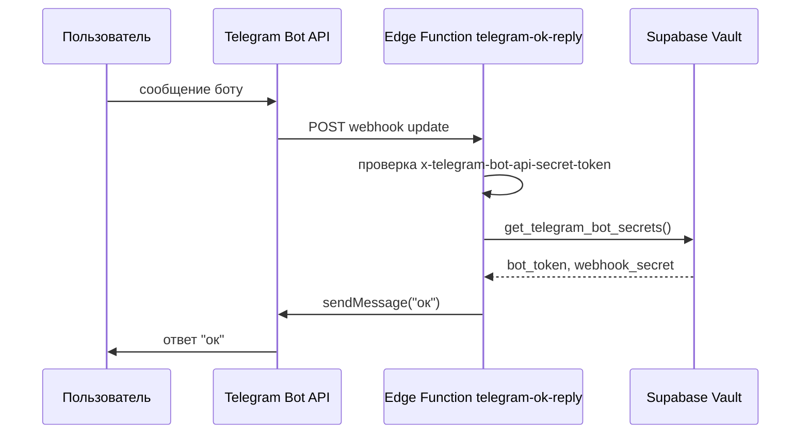

# Telegram-бот `telegram-ok-reply`

Минимальный Telegram-бот на Supabase Edge Function: на любое входящее сообщение отвечает `ок`.

## Архитектура



## Файлы

| Путь | Назначение |
|------|------------|
| `supabase/functions/telegram-ok-reply/index.ts` | Webhook handler |
| `supabase/config.toml` | `verify_jwt = false` для Telegram |
| `supabase/migrations/20260916180000_create_telegram_bot_state.sql` | Таблица состояния (зарезервировано) |
| `supabase/migrations/20260916180500_telegram_bot_secrets_rpc.sql` | RPC чтения секретов из Vault |

## Секреты

Токен бота и webhook secret **не хранятся в коде**. Допустимые источники:

1. **Supabase Vault** (рекомендуется для продакшена):
   - `telegram_bot_token` — токен от @BotFather
   - `telegram_poll_secret` — произвольная строка для `secret_token` webhook

2. **Env Edge Function** (альтернатива):
   - `TELEGRAM_BOT_TOKEN`
   - `TELEGRAM_WEBHOOK_SECRET` или `TELEGRAM_POLL_SECRET`

`SUPABASE_URL` и `SUPABASE_SERVICE_ROLE_KEY` доступны функции автоматически.

### Запись секретов в Vault

```sql
select vault.create_secret('<TELEGRAM_BOT_TOKEN>', 'telegram_bot_token', 'Telegram bot token');
select vault.create_secret('<WEBHOOK_SECRET>', 'telegram_poll_secret', 'Webhook secret token');
```

Или через CLI:

```bash
supabase secrets set TELEGRAM_BOT_TOKEN="123456:ABC..."
supabase secrets set TELEGRAM_WEBHOOK_SECRET="your-random-secret"
```

## Деплой

```bash
supabase db push --project-ref yxxwpsodzksvxpvizybt
supabase functions deploy telegram-ok-reply --project-ref yxxwpsodzksvxpvizybt
```

URL функции:

```
https://yxxwpsodzksvxpvizybt.supabase.co/functions/v1/telegram-ok-reply
```

## Регистрация webhook

```bash
curl -X POST "https://api.telegram.org/bot<TELEGRAM_BOT_TOKEN>/setWebhook" \
  -d "url=https://yxxwpsodzksvxpvizybt.supabase.co/functions/v1/telegram-ok-reply" \
  -d "secret_token=<WEBHOOK_SECRET>"
```

Проверка:

```bash
curl "https://api.telegram.org/bot<TELEGRAM_BOT_TOKEN>/getWebhookInfo"
```

Ожидаемый результат: `url` указывает на Edge Function, `pending_update_count: 0`.

## Поведение endpoint

| Метод | Ответ |
|-------|-------|
| `GET` | `ok` (healthcheck) |
| `POST` без валидного secret | `401 Unauthorized` |
| `POST` с update без chat.id | `200`, без отправки сообщения |
| `POST` с сообщением | `200`, бот отвечает `ок` |

Telegram передаёт secret в заголовке `x-telegram-bot-api-secret-token`.

## Локальная разработка

```bash
supabase functions serve telegram-ok-reply --env-file supabase/.env.local --no-verify-jwt
```

Для локального теста webhook нужен туннель (ngrok, cloudflared) — Telegram не шлёт update на `localhost`.

## Безопасность

- Токен бота только на сервере (Vault / env Edge Function).
- Webhook проверяет `secret_token` — без него update отклоняется.
- RPC `get_telegram_bot_secrets()` недоступен для `anon` и `authenticated`.
- Не коммитьте токены в git.

## Troubleshooting

**Бот не отвечает**

1. Проверьте webhook: `getWebhookInfo` — URL и `last_error_date`.
2. Проверьте секреты в Vault / env функции.
3. Посмотрите логи Edge Function в Supabase Dashboard → Edge Functions → `telegram-ok-reply`.

**401 Unauthorized**

- `secret_token` в `setWebhook` не совпадает с секретом в Vault/env.

**500 Server is not configured**

- Нет `telegram_bot_token` или `telegram_poll_secret` в Vault, и не заданы env-переменные.
