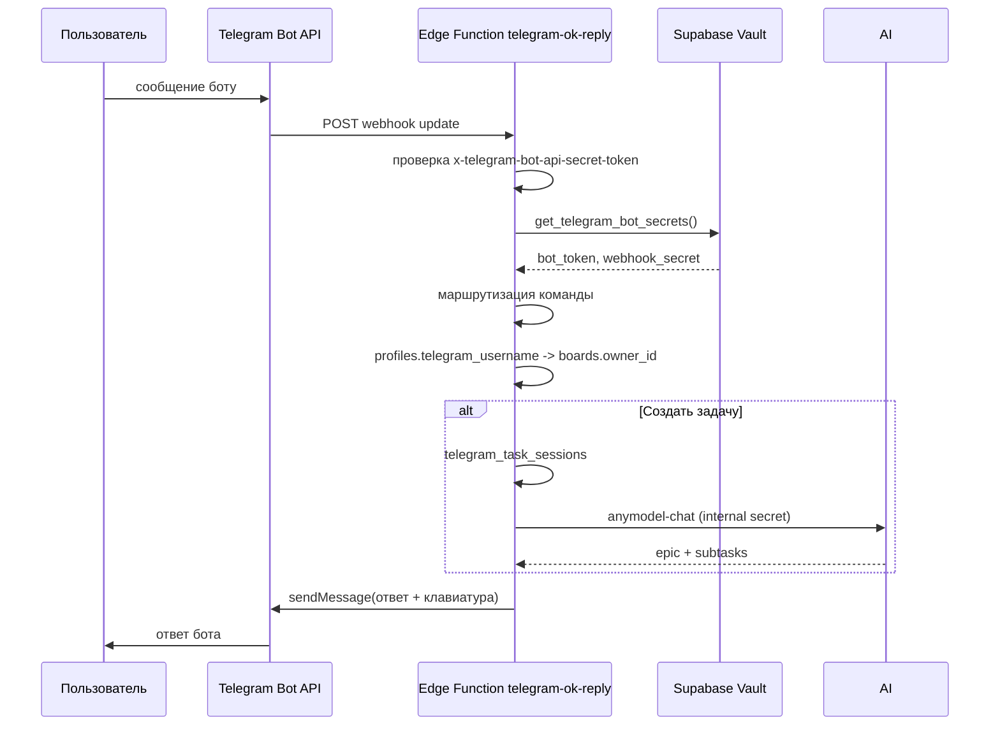

# Telegram-бот `telegram-ok-reply`

Telegram-бот на Supabase Edge Function: показывает **ваши** доски, создаёт глобальные задачи через AI с выбором доски и отвечает `ок` на остальные сообщения.

## Архитектура



## Файлы

| Путь | Назначение |
|------|------------|
| `supabase/functions/telegram-ok-reply/index.ts` | Webhook handler |
| `supabase/config.toml` | `verify_jwt = false` для Telegram |
| `supabase/migrations/20260916180000_create_telegram_bot_state.sql` | Таблица состояния (зарезервировано) |
| `supabase/migrations/20260916180500_telegram_bot_secrets_rpc.sql` | RPC чтения секретов из Vault |
| `supabase/migrations/20260916182000_create_telegram_task_sessions.sql` | Сессии диалога «Создать задачу» |
| `supabase/migrations/20260916183500_telegram_dedup_processing.sql` | Состояние `processing` и дедуп по `update_id` |
| `supabase/functions/anymodel-chat/index.ts` | AI split + persist (web JWT и Telegram internal mode) |

## Секреты

Токен бота и webhook secret **не хранятся в коде**. Допустимые источники:

1. **Supabase Vault** (рекомендуется для продакшена):
   - `telegram_bot_token` — токен от @BotFather
   - `telegram_poll_secret` — произвольная строка для `secret_token` webhook

2. **Env Edge Function** (альтернатива):
   - `TELEGRAM_BOT_TOKEN`
   - `TELEGRAM_WEBHOOK_SECRET` или `TELEGRAM_POLL_SECRET`
   - `TELEGRAM_INTERNAL_SECRET` — общий секрет для вызова `anymodel-chat` из `telegram-ok-reply`

`SUPABASE_URL` и `SUPABASE_SERVICE_ROLE_KEY` доступны функции автоматически.

### Запись секретов в Vault

```sql
select vault.create_secret('<TELEGRAM_BOT_TOKEN>', 'telegram_bot_token', 'Telegram bot token');
select vault.create_secret('<WEBHOOK_SECRET>', 'telegram_poll_secret', 'Webhook secret token');
```

Или через CLI:

```bash
supabase secrets set TELEGRAM_BOT_TOKEN="123456:ABC..."
supabase secrets set TELEGRAM_WEBHOOK_SECRET="your-random-secret"
```

## Деплой

```bash
supabase db push --project-ref yxxwpsodzksvxpvizybt
supabase functions deploy telegram-ok-reply --project-ref yxxwpsodzksvxpvizybt
supabase functions deploy anymodel-chat --project-ref yxxwpsodzksvxpvizybt
supabase secrets set TELEGRAM_INTERNAL_SECRET="your-internal-secret"
```

URL функции:

```
https://yxxwpsodzksvxpvizybt.supabase.co/functions/v1/telegram-ok-reply
```

## Регистрация webhook

```bash
curl -X POST "https://api.telegram.org/bot<TELEGRAM_BOT_TOKEN>/setWebhook" \
  -d "url=https://yxxwpsodzksvxpvizybt.supabase.co/functions/v1/telegram-ok-reply" \
  -d "secret_token=<WEBHOOK_SECRET>"
```

Проверка:

```bash
curl "https://api.telegram.org/bot<TELEGRAM_BOT_TOKEN>/getWebhookInfo"
```

Ожидаемый результат: `url` указывает на Edge Function, `pending_update_count: 0`.

## Быстрый старт для пользователя бота

1. Укажите ваш Telegram username в веб-приложении: **Настройки**.
2. Откройте бота в Telegram и отправьте `/start`.
3. **Список досок** — покажет только ваши доски.
4. **Создать задачу** → выберите доску inline-кнопкой → отправьте текст глобальной задачи.
5. Бот создаст эпик и подзадачи через `anymodel-chat` и пришлёт summary.
6. `/cancel` отменяет создание задачи.
7. Любое другое сообщение получит ответ `ок`.

## Команды и кнопки

| Ввод пользователя | Ответ бота |
|-------------------|------------|
| `/start` | Приветствие + кнопки `Список досок` и `Создать задачу` |
| `Список досок` или `/boards` | Список досок владельца по `message.from.username` → `profiles.telegram_username` |
| `Создать задачу` или `/task` | Inline-выбор доски → ввод текста → AI split через `anymodel-chat` |
| `/cancel` или `Отмена` | Отмена текущего создания задачи |
| Любой другой текст | `ок` (если не ждём текст задачи) |

### Ошибки при запросе списка досок

| Ситуация | Ответ бота |
|----------|------------|
| У аккаунта Telegram нет username | Инструкция задать username в Telegram или в Настройках приложения |
| Username не привязан к профилю | Инструкция указать @username в «Настройках» веб-приложения |
| Профиль найден, досок нет | `У вас пока нет досок.` |

Формат списка досок:

```
Ваши доски:
1. Название доски (uuid)
2. Другая доска (uuid)
```

Если досок больше 30, сообщение обрезается и добавляется строка `и еще N...`.

### Создание задачи через AI

1. Пользователь нажимает **Создать задачу**.
2. Если доска одна — выбирается автоматически.
3. Если досок несколько — бот показывает inline-кнопки с названиями.
4. После выбора доски бот просит текст глобальной задачи.
5. `telegram-ok-reply` вызывает `anymodel-chat` с заголовком `x-telegram-internal-secret` и payload `{ profileId, boardId, title }`.
6. В backlog выбранной доски создаются эпик и подзадачи с назначениями.

Защита от дублей: перед вызовом AI сессия переходит в `processing`, а после успеха `update_id` Telegram сохраняется в `telegram_processed_updates`. Повторная доставка того же webhook не создаст второй эпик.

Пример summary:

```
Задача создана на доске «Моя доска»
Эпик: Запустить MVP
Подзадач: 5
Исполнители: Иван, Мария
```

## Поведение endpoint

| Метод | Ответ |
|-------|-------|
| `GET` | `ok` (healthcheck) |
| `POST` без валидного secret | `401 Unauthorized` |
| `POST` с update без chat.id | `200`, без отправки сообщения |
| `POST` с сообщением | `200`, бот отвечает по таблице выше |

Telegram передаёт secret в заголовке `x-telegram-bot-api-secret-token`.

## Локальная разработка

```bash
supabase functions serve telegram-ok-reply --env-file supabase/.env.local --no-verify-jwt
```

Для локального теста webhook нужен туннель (ngrok, cloudflared) — Telegram не шлёт update на `localhost`.

## Уведомления о назначении задач

Назначения из веб-доски и из AI-оркестратора используют одну и ту же таблицу `task_assignees`. Уведомления в Telegram построены поверх серверного пайплайна БД:

1. `telegram-ok-reply` фиксирует связь профиля и чата (`telegram_profile_links`) после валидного апдейта от пользователя.
2. `AFTER INSERT` trigger на `task_assignees` ставит запись в очередь `telegram_assignment_notifications` только для профилей с подтвержденной связью.
3. Edge Function `telegram-assignment-notify` отправляет pending-уведомления и отмечает `sent`, а при ошибках делает retry.
4. Cron-job (`pg_cron` + `pg_net`) вызывает `telegram-assignment-notify` раз в 2 минуты.

### Что считается «подключен к боту»

Пользователь считается подключенным, если есть строка в `telegram_profile_links`:

- `profile_id` пользователя;
- актуальный `chat_id`;
- timestamp `last_seen_at`.

Практически это происходит после `/start` (или другого сообщения) от Telegram-аккаунта с username, привязанным к `profiles.telegram_username`.

### Таблицы и функции

- `telegram_profile_links` — связь `profile_id <-> chat_id`.
- `telegram_assignment_notifications` — очередь отправок (`pending | sent | failed`, `attempts`, `error`).
- `enqueue_telegram_assignment_notification()` — trigger-function для постановки в очередь.
- `invoke_telegram_assignment_notify()` — SQL-функция для cron-вызова notify endpoint.

### Секреты для assignment notify

Дополнительно к секретам webhook/AI нужен общий внутренний секрет:

- `TELEGRAM_INTERNAL_SECRET` в env Edge Functions (`telegram-ok-reply`, `telegram-assignment-notify`, `anymodel-chat`);
- такой же секрет в Vault под именем `telegram_internal_secret` для cron-вызова.

Пример (Vault):

```sql
select vault.create_secret('<TELEGRAM_INTERNAL_SECRET>', 'telegram_internal_secret', 'Internal secret for telegram assignment notify cron');
```

## Безопасность

- Токен бота только на сервере (Vault / env Edge Function).
- Webhook проверяет `secret_token` — без него update отклоняется.
- RPC `get_telegram_bot_secrets()` недоступен для `anon` и `authenticated`.
- Список досок читается через `SUPABASE_SERVICE_ROLE_KEY`, но фильтруется по `profiles.telegram_username` и `boards.owner_id`.
- Без привязанного username бот не показывает чужие доски.
- Не коммитьте токены в git.

## Troubleshooting

**Бот не отвечает**

1. Проверьте webhook: `getWebhookInfo` — URL и `last_error_date`.
2. Проверьте секреты в Vault / env функции.
3. Посмотрите логи Edge Function в Supabase Dashboard → Edge Functions → `telegram-ok-reply`.

**401 Unauthorized**

- `secret_token` в `setWebhook` не совпадает с секретом в Vault/env.

**500 Server is not configured**

- Нет `telegram_bot_token` или `telegram_poll_secret` в Vault, и не заданы env-переменные.

**Не создаётся задача через AI (`TELEGRAM_INTERNAL_SECRET is not configured`)**

- Задайте один и тот же `TELEGRAM_INTERNAL_SECRET` для Edge Functions `telegram-ok-reply` и `anymodel-chat`:

```bash
supabase secrets set TELEGRAM_INTERNAL_SECRET="your-random-secret" --project-ref yxxwpsodzksvxpvizybt
```

После смены секрета перезадеплойте обе функции.

**Нет уведомлений о назначении**

1. Проверьте, что пользователь написал боту и есть запись в `telegram_profile_links`.
2. Проверьте очередь:
   - `telegram_assignment_notifications.status='pending'` или `failed`.
3. Проверьте, что active cron-job `telegram-assignment-notify` существует.
4. Проверьте наличие Vault-секрета `telegram_internal_secret` и совпадение с `TELEGRAM_INTERNAL_SECRET`.
5. Проверьте логи функции `telegram-assignment-notify`.
